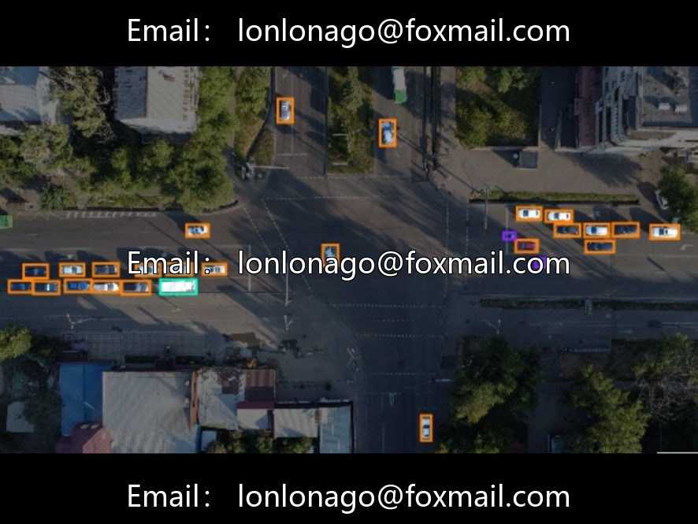
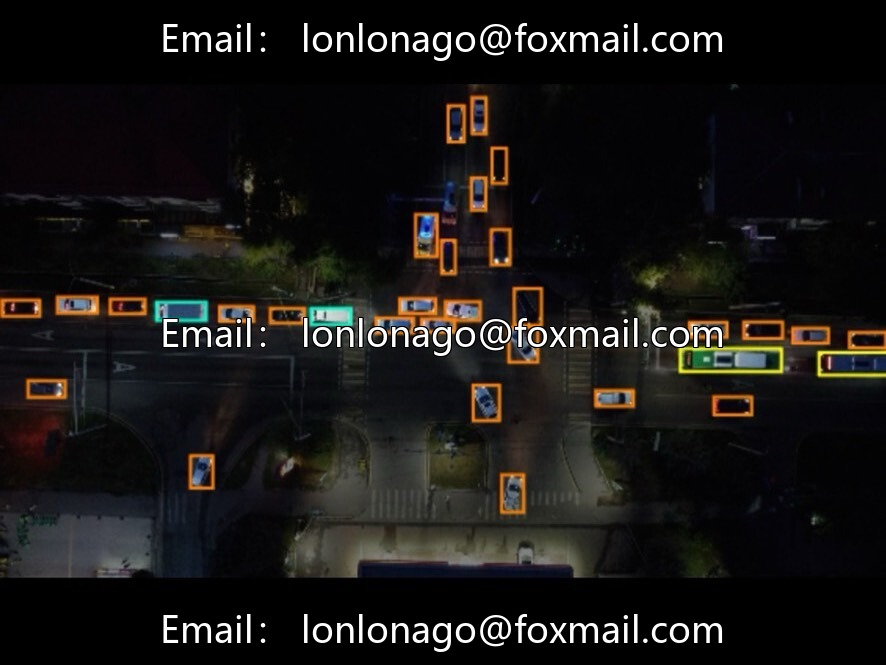
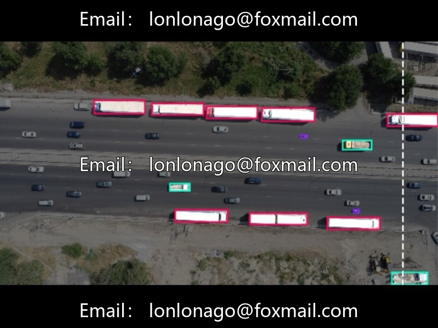
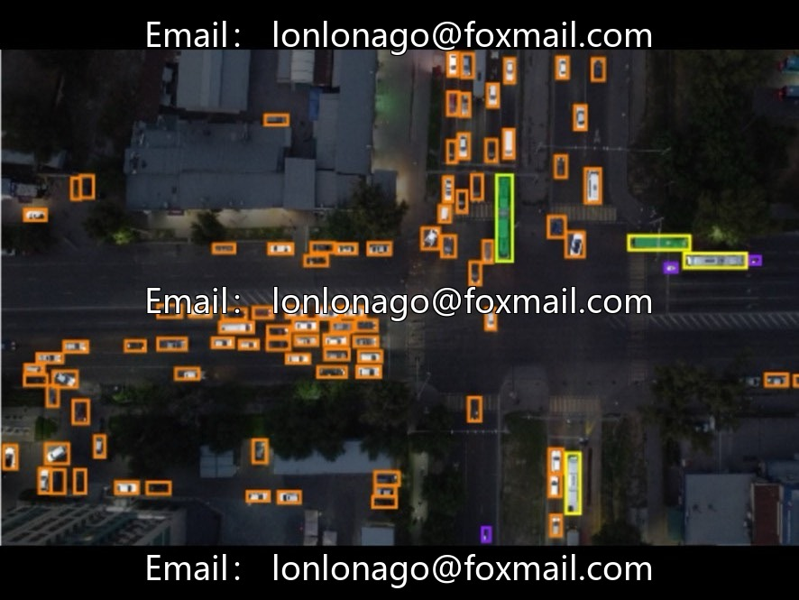

# Drone aerial photography vehicle recognition dataset, issue 10016

## Body

Drone aerial vehicle recognition dataset, issue 10016
Designed specifically for drone-based air vehicle target detection, compatible with the Detectron2 framework, suitable for model training and validation related to traffic monitoring and aerial inspection.

The dataset consists of 2698 images (approximately 27k), belonging to a medium-sized dataset.
It contains 8 categories of vehicles: PMT small mobility vehicle, articulated bus, regular bus, sedan, truck, motorcycle, minibus, and truck.
It covers various types of civilian, passenger, and freight vehicles.
Sample distribution: Sedan is the most abundant, followed by buses, trucks, and less common models such as motorcycles and articulated buses.
The images are from an aerial perspective, including urban roads, highways, parking lots, and other diverse scenes.
The images do not have explicit resolution labels, containing samples at different aerial heights, balancing high and low resolution views, and adapting to distant and close scale vehicle targets.
The images have been preprocessed to fit the input size for the model.

Primarily for aerial vehicle recognition of small targets, it can be used in scenarios such as urban traffic flow statistics, drone traffic inspection, and the research and development of airborne target detection algorithms.

Virtual materials, once sold, are non-refundable.
Interested friends, click "I want" to proceed.

## Images

## Payment

Here is a pay link on Stripe ( https://buy.stripe.com/3cs8yP7sY87d0vu9AB ). Please contact me lonlonago@foxmail.com after funding $89, and I will send you a complete data files , thank you!

